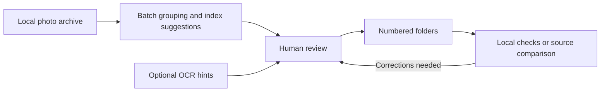

# Zhastar Media Toolkit

Python tools for turning a messy photo archive into folders that a person can review and use.

Built from a media-organisation project for **Zhastar Üni** in Almaty, Kazakhstan. The workflow combines photo grouping, optional OCR hints and a desktop review interface. A person makes the final assignment; OCR and message proximity provide suggestions.

## Why I built it

During my work with Zhastar Üni, photographs arrived through Telegram in batches. Preparing them for reports meant finding the right index image, matching related photographs, correcting ambiguous groups and checking that files had not disappeared between steps.

I built tools to reduce that repetitive work while keeping a person in control of uncertain decisions. The organisation's recommendation describes a wider assignment involving **2,104 media files and 403 folders**. Those are historical project-context figures, not a benchmark of this public release. The original photographs and account data are not included here.

My work on the project involved translating the organisation's requirements into a workflow, developing and revising the tools, and checking the output with the people using it.

## What is in this repository

This is a **reconstructed and hardened release of recovered tools**, rather than a claim that the exact final historical pipeline has been recovered. The archived scripts and final logs used different formats. This release makes the surviving tools runnable on a synthetic example and fixes identified issues.

| Tool | Purpose |
|---|---|
| `visual_review.py` | Review albums, compare index photographs, assign folders and move selected images |
| `index_browser.py` | Browse a read-only gallery of numbered folders' index images |
| `verify_completeness.py` | Find unassigned images, duplicate message IDs, empty/corrupt files and source-inventory differences |
| `redownload_missing.py` | Optionally recover explicitly requested image messages from Telegram |
| `ocr_batch.py` | Optionally obtain number suggestions from Google Vision |
| `sorting_core.py`, `shared.py` | Grouping, state, safe paths and file operations |

The general-purpose original Telegram ingestion pipeline is not part of the recovered source. Recovery of specific messages is supported; automatic initial ingestion of an entire chat is not.



## Try it without accounts

Use **Python 3.10 or newer**. The desktop tools also require Tkinter, included in many Python desktop installations. On Linux, the system `python3-tk` package may be needed.

```sh
python -m venv .venv
```

Activate the environment:

```powershell
# Windows PowerShell
.\.venv\Scripts\Activate.ps1
```

```sh
# macOS / Linux
source .venv/bin/activate
```

Then:

```sh
python -m pip install -r requirements.txt
python make_demo.py
python visual_review.py
```

The demo contains eight generated building-photo cards, with no real people, addresses or locations. It deliberately includes unassigned albums so you can try the review workflow. The generator refuses to overwrite a nonempty destination; use `--output another_demo/sorted` for a fresh copy.

### What to try

1. In **Phase A**, inspect the suggested match for Building 2 and confirm its destination.
2. Read the index card in the mixed Building 3 batch and enter `3`.
3. Assign the unmatched Building 4 card manually.
4. Switch to the folder checks or open the gallery:

```sh
python index_browser.py
python verify_completeness.py --local-only --validate-images
python visual_review.py --report
```

The verifier returns exit code **1** when it finds items needing review, **0** when the selected checks find none, and **2** for invalid arguments/setup. The untouched demo is expected to need review. Neither the local verifier nor report mode contacts an external service. Report mode writes `manifest.csv` in the selected data directory.

### Use your own copy of an archive

```sh
python visual_review.py --data-dir "path/to/archive-copy"
python index_browser.py --data-dir "path/to/archive-copy"
python verify_completeness.py --data-dir "path/to/archive-copy" --validate-images
```

Expected layout:

```text
archive-copy/
├── 1/
│   ├── msg_100.jpg
│   └── msg_101.heic
├── 2/
├── _unsorted/
│   ├── msg_200.png
│   └── batch_001/
│       ├── msg_300.heic
│       └── msg_301.jpg
└── _singles/
```

JPEG, PNG, WebP, HEIC and HEIF are supported. Explicit nested batch folders keep their album boundaries. For loose images, nearby Telegram message IDs are a heuristic for grouping, not proof that photographs belong together. An index JPG is a suggestion too; multiple JPGs or unrelated numbers can be ambiguous.

## Optional Telegram tools

```sh
python -m pip install -r requirements-telegram.txt
```

Set `TELEGRAM_API_ID` and `TELEGRAM_API_HASH` in your local environment using your own Telegram application credentials. `.env.example` documents the variable names; it is a template and is not automatically loaded. By default, a new local session is stored under the ignored `.private/` directory. `TELEGRAM_SESSION_PATH` can point to a location outside this repository.

Preview a recovery request without connecting:

```sh
python redownload_missing.py --data-dir "path/to/archive-copy" --group YOUR_GROUP --ids 100,101
```

Adding `--apply` authenticates to Telegram and downloads available missing images. The tool uses a group already accessible to your account; it does not join groups or send messages. Existing nonempty images are skipped. Downloaded files are checked before being added to `_unsorted`.

Explicitly request a read-only Telegram comparison:

```sh
python verify_completeness.py --data-dir "path/to/archive-copy" --telegram --group YOUR_GROUP
```

`--group-id` is an alias for `--group`. You can instead compare against an offline JSON inventory:

```json
[{"group_id": "example-album", "msg_ids": [100, 101]}]
```

```sh
python verify_completeness.py --data-dir "path/to/archive-copy" --inventory my_inventory.json
```

## Optional OCR

```sh
python -m pip install -r requirements-ocr.txt
python ocr_batch.py --data-dir "path/to/archive-copy"
```

The default command is an offline preview. `--apply` sends candidate images to **Google Cloud Vision** and may incur charges. Only use images you are allowed to send to that service. Configure [Application Default Credentials](https://docs.cloud.google.com/vision/docs/authentication) locally; there is no built-in credential file or machine-specific key path.

Successful results are cached by relative path and content hash. Failed requests are retried on a later run; `--force` repeats successful requests too. OCR numbers remain suggestions requiring human review.

## File safety and limitations

- Destination names must stay inside the selected archive. Traversal paths and reserved names are rejected.
- Name collisions produce `_dup1`, `_dup2`, etc. Existing files are not overwritten.
- A batch pre-checks its sources and attempts rollback on ordinary mid-operation failures. Exact paths and operation states are recorded in `_state/moves.jsonl`.
- A power loss, interrupted journal write, or failed rollback still requires manual recovery from the journal and a backup. There is no automatic undo command. Do not run multiple writers against the same archive.
- Review CSV files are replaced atomically. The recovery journal is separate; if a GUI review-log write fails after a committed move, inspect the journal before retrying.
- No original photographs, Telegram sessions, account keys or real OCR caches are bundled. Keep private archives outside the repository.
- The toolkit checks files, IDs and layout. It cannot prove that a photograph was assigned to the correct building or that the current Telegram history includes every historical message.

## Tests

```sh
python -m unittest discover -s tests -v
```

The regression suite runs offline on temporary files and synthetic images. It covers nested batches, collisions, rollback, duplicate IDs, legacy review logs, OCR retries, cache identity and explicit group selection. Telegram and Vision integrations are tested with mocks; the public release has not been validated against a live account. A separate GUI smoke check is available in `tests/gui_smoke.py` for a desktop environment.

## Project status

This is a portfolio and recovery release of a practical internal tool. The recovery/refactoring work in this release was AI-assisted. See [CHANGELOG.md](CHANGELOG.md) for the distinction between the historical workflow and changes made for publication.

Author / project owner: **Altair Magauya**.
